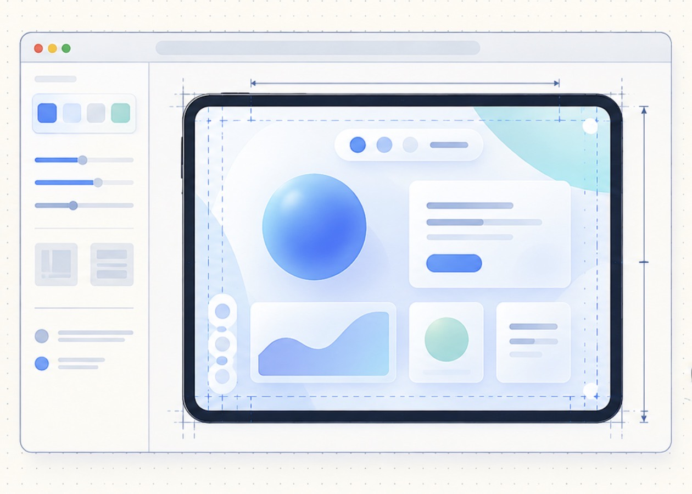

# Apple Prototyping

**Give your coding agent a device playground before it writes SwiftUI or UIKit.**

A screen can look convincing in a mockup and fall apart when the device rotates,
the window narrows, or a toolbar moves to another edge. Apple Prototyping gives
Codex a reusable skill and a browser playground for exploring those decisions
before committing to native implementation.

The agent builds your app concept in HTML/CSS, places it inside explicit device
bounds, and checks how the layout responds to different sizes, orientations and
fold poses. You get an interactive prototype you can walk through with a client
right in the browser.

## Resolve layout questions before writing native code

| The question | What the playground lets the agent do |
| --- | --- |
| Does this screen work beyond one screenshot? | Switch between 13 presets covering phone, iPad, Duo, fold poses and a narrow window; try custom dimensions too. |
| What happens when the device rotates? | Rotate the viewport and inspect how content and controls reflow while application state stays in place. |
| Are controls clear of the safe area and camera? | Overlay recorded safe-area and occlusion guides for measured presets, and simulate active occlusions. |
| Where should controls go in tabletop mode? | Explore content on one panel and controls on the other while preserving the full display proportions. |
| Is the design ready to discuss with a client? | Present the working screen in a browser, change device modes live, and compare layout choices together. |

The skill guides the agent to use **the simulated device's dimensions** for
responsive layout. Shrinking the preview to fit a browser window does not change
its logical size. That means the agent can reason about the space available to
content instead of accidentally designing for the desktop browser around it.

## From an idea to a client walkthrough

1. **Describe the screen and target devices.** Give the agent the user flow,
   content, visual references and the modes you want to explore.
2. **Build and inspect in the playground.** The agent creates an HTML/CSS
   prototype, switches devices and orientations, and checks screenshots and
   element bounds for clipping, overlap and unreachable controls.
3. **Review and annotate in Codex.** The agent opens the running prototype in
   Codex's built-in browser and invites you to annotate anything that looks off.
   Point to the element and describe the change; the agent uses that feedback to
   revise the layout and show the updated result. You can also walk a client
   through the static site locally or publish it to your own hosting.
4. **Carry the decisions into SwiftUI or UIKit.** Use the reviewed composition,
   control placement and adaptation rules as implementation inputs, then verify
   the native result in Simulator and on devices.

For example, ask Codex:

```text
Use $apple-device-prototyping to prototype our reading screen before we
implement it in SwiftUI. Include a title, illustration, text, page navigation
and audio controls. Explore phone portrait and landscape, iPad, and Duo
including tabletop. Keep reading progress when switching modes. Check for
clipping and control overlap, then prepare a browser walkthrough for the client.
Open it in Codex's built-in browser so I can annotate visual changes.
Identify which geometry is measured and which is a layout fixture.
```

## Start using the skill

Clone this repository and install the skill from your local checkout:

```sh
git clone https://github.com/SoundBlaster/apple-prototyping.git
cd apple-prototyping
mkdir -p ~/.codex/skills
ln -s "$PWD/skills/apple-device-prototyping" ~/.codex/skills/apple-device-prototyping
```

Use an unused destination for the symlink. You can also point Codex directly to
[SKILL.md](skills/apple-device-prototyping/SKILL.md).
Invoke `$apple-device-prototyping` with your screen brief to begin.

To explore the included sample playground:

```sh
npm run serve
# Open http://localhost:8766
```

To create a standalone prototype in a new directory:

```sh
python3 skills/apple-device-prototyping/scripts/create_prototype.py /tmp/my-device-prototype
python3 -m http.server 8000 --directory /tmp/my-device-prototype
# Open http://localhost:8000
```

The starter runs without a build step or frontend dependencies. It needs a static
HTTP server and a modern browser. Replace the sample content with your app;
existing HTML prototypes can also use just the device kit.

## Dimensions you can trace

Have a device or window configuration missing from the catalog? Run the
[native Geometry Scanner](native/GeometryScanner/README.md) on an iPhone, iPad or
Simulator. It records the owning view's dimensions, safe area and configuration,
then exports JSON with a companion screenshot. Import that JSON in the playground
to review your prototype using the captured geometry. Separate observations keep
portrait, landscape and system-panel configurations distinct.

The playground keeps logical dimensions separate from preview scaling and labels
the source of its geometry. **Duo presets replay exact recorded bounds, safe-area
insets and regions from an iOS 27.1 Simulator capture.** Those measurements belong
to that recorded configuration; they are not a guarantee for every OS or system
chrome configuration.

Ordinary phone/iPad presets, custom sizes and the large foldable are explicitly
labeled layout fixtures. Changing a measured preset's dimensions clears its
recorded safe-area geometry so the agent cannot silently reuse stale values.
See the [geometry records and provenance](skills/apple-device-prototyping/references/geometry.md).

Use the browser to validate layout decisions and communicate intent. Native
rendering, system toolbar behavior, touch and accessibility still need validation
in SwiftUI/UIKit. The skill does not generate Swift code automatically.

## Extend and verify

The reusable kit owns device geometry, preview scaling, diagnostic overlays and
pointer coordinate mapping. Your prototype owns its content, styling, layout and
state. See the [integration guide](skills/apple-device-prototyping/references/integration.md)
to embed the kit in an existing prototype.

Run `npm test` for geometry checks. The reusable
[Playwright smoke check](skills/apple-device-prototyping/scripts/browser-smoke.mjs)
covers all 13 presets, state persistence, occlusion visibility, custom-size
labeling, pointer mapping, instance isolation and teardown. Each app prototype
also needs its own visual review; see [validation](skills/apple-device-prototyping/references/validation.md).

MIT licensed. The device kit carries its license when copied into another project.
