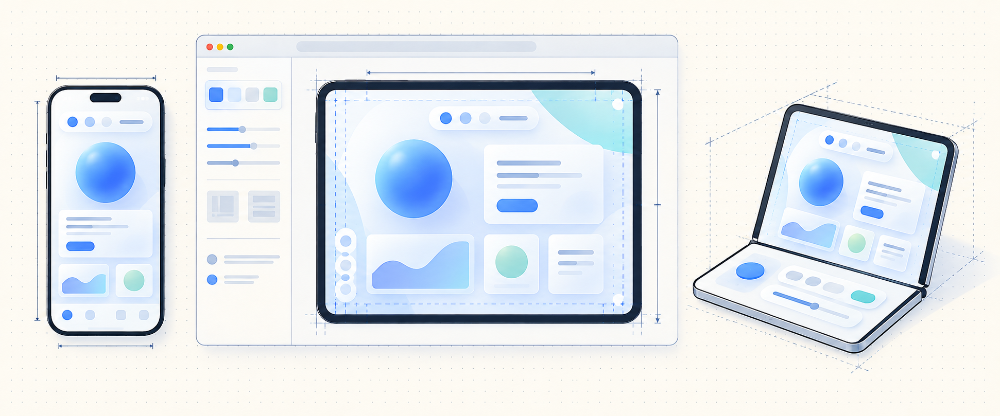

# Apple prototyping

A reusable Codex skill and dependency-free HTML device-layout kit for iPhone,
iPad and foldable design studies. It was separated from a book prototype; no
book content or application-specific behavior ships here.

## Use the skill

Install `skills/apple-device-prototyping` into your Codex skills directory, or
reference its [SKILL.md](skills/apple-device-prototyping/SKILL.md) directly.
For a checkout-based local installation:

```sh
ln -s /absolute/path/apple-prototyping/skills/apple-device-prototyping ~/.codex/skills/apple-device-prototyping
```

Choose an unused destination; don't replace an existing skill installation.
Invoke `$apple-device-prototyping` to create or adapt an HTML device workbench.

## Run or generate

```sh
npm run serve
# Open http://localhost:8766
python3 skills/apple-device-prototyping/scripts/create_prototype.py /tmp/my-device-prototype
python3 -m http.server 8000 --directory /tmp/my-device-prototype
npm test
```

Node is needed only for tests; the starter itself needs only a static HTTP server
and a modern browser with ES modules, container queries and ResizeObserver.

The framework owns geometry presets, scale, diagnostic masks and coordinate
mapping. The sample application owns its styling, content, layout and state.
Existing applications can import just `device-kit/` without adopting the demo UI.
See [integration](skills/apple-device-prototyping/references/integration.md).

Duo dimensions replay recorded iOS27.1 Simulator measurements. Custom viewports,
ordinary phone/iPad sizes and the large foldable are explicitly fixtures. This
is a browser layout workbench, not an iOS emulator or proof of native behavior.
See [provenance](skills/apple-device-prototyping/references/geometry.md).

MIT licensed; the kit carries its own license when copied into another project.

Browser integration checks are in `skills/apple-device-prototyping/scripts/browser-smoke.mjs`. Import
`runBrowserSmoke(page, baseURL)` from a Playwright runner with the starter served.
It checks all 13 presets, state persistence, custom-size provenance, pointer
mapping, instance isolation and teardown. Screenshots still need visual review.
