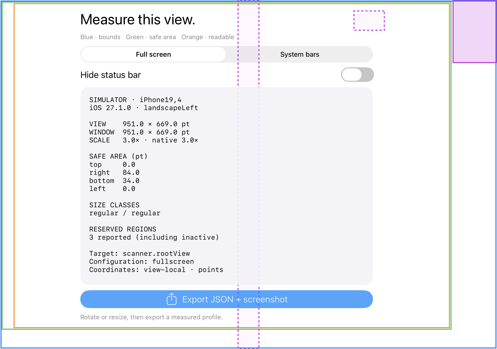
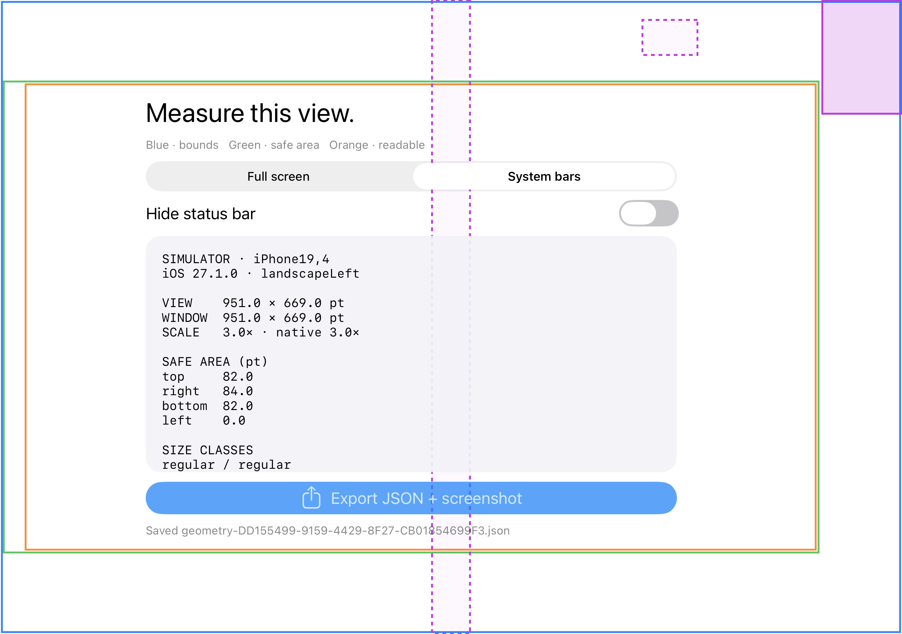
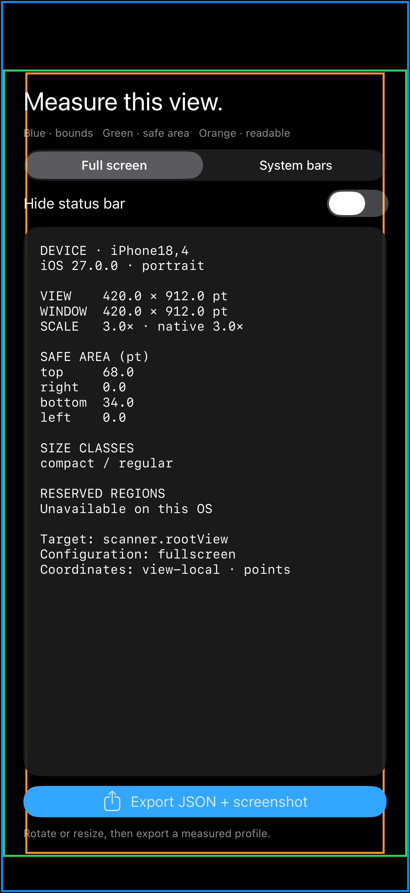
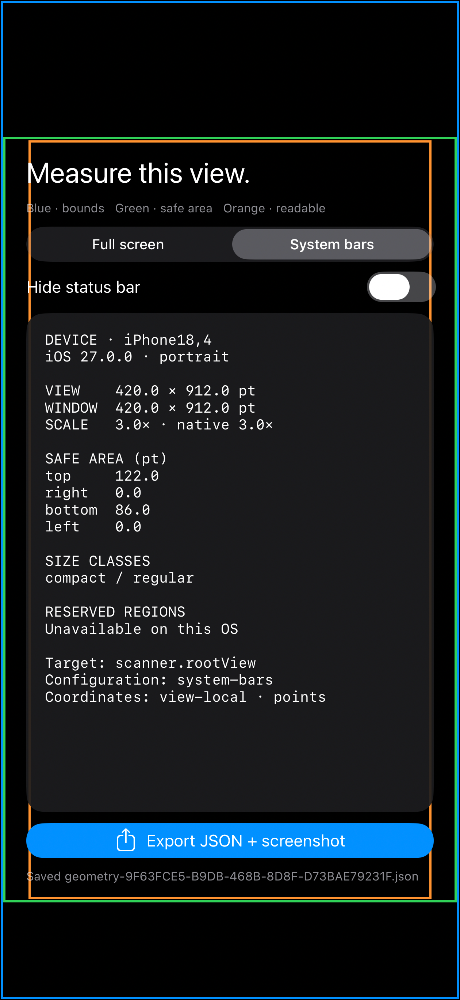
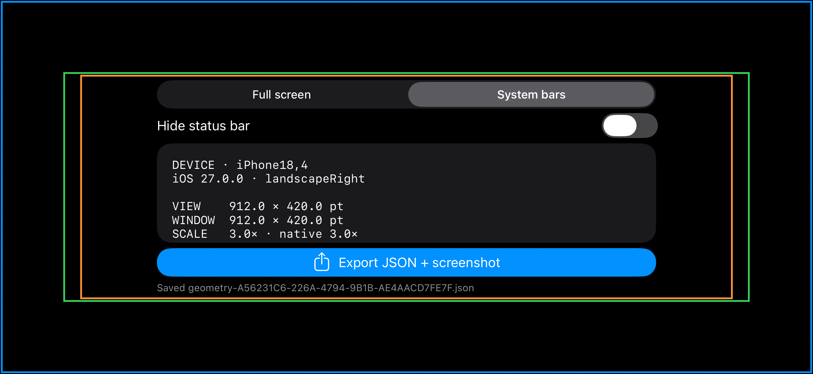
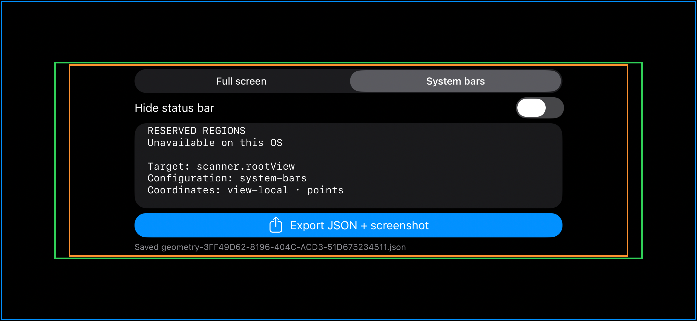
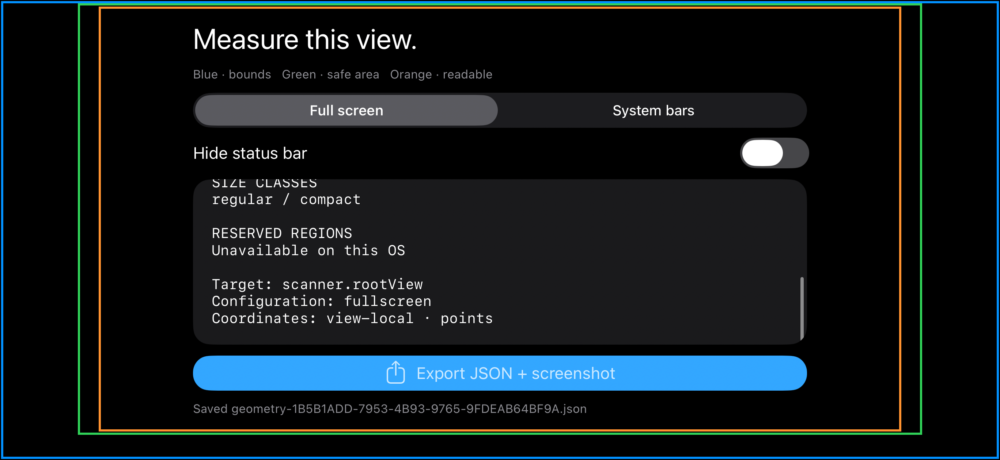

# Scanner → browser verification, 2026-10-15

## Duo Simulator

These are actual app-export pairs from the iPhone Duo Simulator, iOS 27.1.0
(24A94401), model identifier iPhone19,4. They are observations of
`scanner.rootView`, not physical-device measurements.

| Capture | Bounds, pt | Safe top / right / bottom / left |
| --- | --- | --- |
| [Full screen](duo-fullscreen-landscape.json) | 951 × 669 | 0 / 84 / 34 / 0 |
| [System bars](duo-system-bars-landscape.json) | 951 × 669 | 82 / 84 / 82 / 0 |

Both use landscapeLeft, visible status bar and no home-indicator auto-hide.
System bars means the scanner's navigation bar and toolbar are visible. Exact
timestamps, traits, source and all region records are inside each JSON.

## Checks completed

- Simulator build and generic iOS build (unsigned) succeeded with Xcode 27.1.
- UI checked on inner portrait/landscape and outer portrait/landscape:
  configuration toggles, status-bar changes and export share sheet worked.
- The compact landscape layout was then adjusted to prioritize the report and
  rechecked on the outer 678 × 466 display. Report scrolling through automation
  remains unverified; full values are present in the JSON.
- Ten Node geometry/import tests passed.
- The 13-preset browser smoke passed, including state, overlays and pointer mapping.
- The actual system-bars export was imported in the browser: 951 × 669 and
  safe insets 82 / 84 / 82 / 0 matched; note count survived import.
  Rotation invalidated measured geometry; reselect restored it; an invalid
  schema was rejected without changing the active profile.
- The sample button was checked inside the imported safe-area rectangle.

The screenshot pairs predate the small compact-height layout adjustment; their
inner landscape presentation and captured geometry are unchanged by it.

## Physical iPhone Air

The signed scanner was installed and launched on the physical iPhone Air
(iPhone18,4), iOS 27.0.0 (24A435). These matching JSON/PNG pairs were exported by
the user from that app; the portrait pairs were also retrieved from its device
container. They measure `scanner.rootView` with home-indicator auto-hide disabled.
The portrait captures have a visible status bar; the landscape capture reports
it hidden. The PNG captures the measured view; system bars themselves
are outside that view's hierarchy and are not drawn in the exported image.

| Capture | Bounds, pt | Safe top / right / bottom / left |
| --- | --- | --- |
| [Full screen](air-fullscreen-portrait.json) | 420 × 912 | 68 / 0 / 34 / 0 |
| [System bars](air-system-bars-portrait.json) | 420 × 912 | 122 / 0 / 86 / 0 |
| [System bars, landscapeRight](air-system-bars-landscape.json) | 912 × 420 | 78 / 68 / 78 / 68 |
| [Full screen, landscapeRight](air-fullscreen-landscape.json) | 912 × 420 | 0 / 68 / 20 / 68 |

All exports have scale 3 and native bounds 1260 × 2736. On this OS version,
`regionsSupported:false` correctly reports that the reserved-regions API is
unavailable. It does not claim that the device has no occluded areas.

All four user-supplied JSON exports (including a repeated system-bars sample)
passed the browser import smoke: dimensions and safe-area insets matched, the
source was `device-measured`, application state survived import, rotation cleared
measured status, reselecting restored it, and invalid schema input preserved the
active profile. Three distinct configurations are retained here.

The Air landscape capture exposed overlapping sample-app text in the browser.
A compact-height container query now reduces the heading and illustration and
puts the caption in normal flow. The import smoke checks title/caption/button
rectangles against the measured safe area and against each other. All four Air
exports passed those checks after the fix, and the 13-preset smoke still passed.

Live device inspection confirmed readable portrait controls and report with no
overlap. The landscape export confirms the compact layout and geometry after a
physical rotation; remote rotation commands did not change the phone's pose.
Two more exports were copied directly from the app's Documents using CoreDevice:
system-bars at 21:14:26Z and full-screen at 21:14:37Z. Both passed the same browser
import and layout checks. The full-screen capture completes the portrait and
landscape matrix for both scanner modes on this Air.

The [later system-bars export](air-system-bars-landscape-scrolled.json) and both
screenshots below show the report at its lower content, unlike the earlier
landscape screenshot. This is evidence that lower report content is reachable
after user interaction; the agent did not automate or observe the swipe itself.

iPad window resizing remains unverified. Build success alone is not
physical-device evidence.
